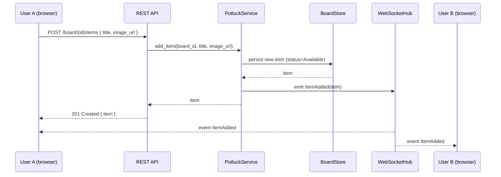
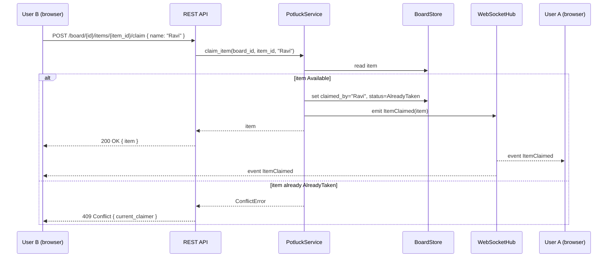
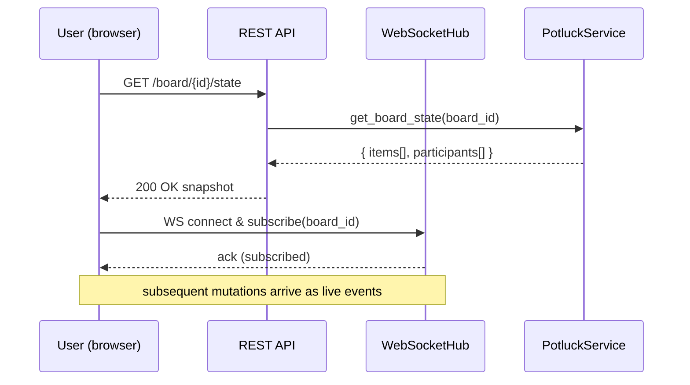

# Design Document: Realtime Potluck Planner

## Overview

The Realtime Potluck Planner is a web application that lets office colleagues coordinate a potluck by adding food items, claiming who brings what, and viewing a live, shared status of every item. The core problem it solves is duplication and waste: without a single shared view, multiple people bring the same dish while others go uncovered. By exposing a realtime, link-shareable board, every participant sees the current state instantly and can make informed choices.

The system is organized around two primary entities, **Items** (a dish to bring) and **Participants** (a named person). An item is either **Available** (no one has claimed it) or **Already Taken** (claimed by exactly one participant, shown as "Bringing: <name>"). The application pushes changes to all connected clients in realtime so that adding an item or claiming one is reflected live for everyone viewing the same shared board.

The design combines a **high-level view** (architecture, sequence diagrams, component interfaces, data models) with a **low-level view** (formal function specifications and algorithmic pseudocode) so the implementation can proceed directly from this document. Code examples use Python for the backend service layer; the realtime transport is WebSocket-based with a REST fallback for initial loads.

## Architecture


The server maintains the authoritative state of each **Board** (one shared potluck identified by a board id embedded in the shareable link). Mutations flow through the `PotluckService`, which validates and applies them to the `BoardStore`, then emits a change event. The `WebSocketHub` broadcasts that change to every client subscribed to the same board, producing realtime updates.

### Shareability Model

A board is addressable by a URL such as `https://<host>/board/{board_id}`. Anyone with the link joins the same board, loads current state over REST, and subscribes to live updates over WebSocket. **By explicit product decision, no authentication is used**; identity is a self-declared display name. This keeps joining frictionless for colleagues sharing a single office link.

> Security note: Because there is no authentication (by design), anyone with the link can add, claim, and unclaim items. This is acceptable for the trusted office context but means the board is effectively public to anyone who obtains the link. See Security Considerations.

## Sequence Diagrams

### Flow 1: Add a Food Item (realtime fan-out)



### Flow 2: Claim an Item



### Flow 3: Client Join & Initial Sync



## Components and Interfaces

### Component 1: PotluckService

**Purpose**: Core business logic. Validates and applies all mutations, computes derived state (status, people grouping), and emits change events.

**Interface**:
```python
class PotluckService:
    def get_board_state(self, board_id: str) -> BoardState: ...
    def add_item(self, board_id: str, title: str, image_url: str | None) -> Item: ...
    def claim_item(self, board_id: str, item_id: str, name: str) -> Item: ...
    def unclaim_item(self, board_id: str, item_id: str, name: str) -> Item: ...
    def list_people(self, board_id: str) -> list[PersonContribution]: ...
```

**Responsibilities**:
- Enforce invariants (unique item ids, one claimer per item, non-empty titles/names).
- Transition item status between `Available` and `AlreadyTaken`.
- Emit `ItemAdded`, `ItemClaimed`, `ItemUnclaimed` events to the hub.
- Derive the "People" view by grouping claimed items per participant name.

### Component 2: BoardStore

**Purpose**: Persistence and retrieval of board state.

**Interface**:
```python
class BoardStore:
    def get_board(self, board_id: str) -> Board | None: ...
    def create_board(self, board_id: str) -> Board: ...
    def save_item(self, board_id: str, item: Item) -> None: ...
    def get_item(self, board_id: str, item_id: str) -> Item | None: ...
    def list_items(self, board_id: str) -> list[Item]: ...
```

**Responsibilities**:
- Store items and board metadata (in-memory map for MVP; swappable for a database).
- Guarantee atomic read-modify-write on a single item (to make claim conflict-safe).

### Component 3: WebSocketHub

**Purpose**: Manage client subscriptions per board and broadcast change events.

**Interface**:
```python
class WebSocketHub:
    def subscribe(self, board_id: str, connection: Connection) -> None: ...
    def unsubscribe(self, connection: Connection) -> None: ...
    def broadcast(self, board_id: str, event: ChangeEvent) -> None: ...
```

**Responsibilities**:
- Track active connections grouped by board id.
- Serialize `ChangeEvent` objects and push to all subscribers of the affected board.
- Clean up dropped connections.

### Component 4: REST API Layer

**Purpose**: HTTP entry point for initial loads and mutations (also serves as a fallback when WebSockets are unavailable).

**Endpoints**:
| Method | Path | Purpose |
|--------|------|---------|
| GET | `/board/{board_id}/state` | Full snapshot (items + people) |
| POST | `/board/{board_id}/items` | Add a food item |
| POST | `/board/{board_id}/items/{item_id}/claim` | Claim an item |
| POST | `/board/{board_id}/items/{item_id}/unclaim` | Release a claim |
| GET | `/board/{board_id}/people` | People view (grouped contributions) |

### Component 5: Web UI

**Purpose**: Browser front-end rendering the item board, people tab, and share action.

**Views**:
- **Item Board**: grid of item cards (image, title, "Bringing: <name>" or "Bringing: Not assigned", status badge green "Already Taken" / grey "Available").
- **People Tab**: list of participants and the item(s) each is bringing.
- **Share**: copyable board link.
- **Landing tiles**: Add Food Items, Add Your Name, Live Item Status, Share with Office.

## Visual Theme & Branding

The UI follows the **PIRNAV "Potluck Week 2026"** festive theme (from the provided banner), evoking an Indian celebration of food, culture, and togetherness.

### Brand & Event Identity
- **Brand**: PIRNAV Software Solutions Pvt. Ltd.
- **Event title**: "Potluck Week 2026" with the tagline "A Celebration of Food, Culture, Tradition & Togetherness".
- **Event dates**: 12th – 16th October 2026 (displayed as an event banner/badge).
- **Closing tagline**: "Come together, share a little, celebrate a lot!".
- **Category motifs** (for landing/section iconography): Traditional Attire, Potluck, Fun Activities, Team Games.

### Color Palette
A warm, festive palette drawn from marigold flowers, brass vessels, and rangoli accents:

| Token | Hex (approx) | Usage |
|-------|--------------|-------|
| `--color-primary` | `#E8551E` (marigold orange) | Primary actions, highlights, logo accents |
| `--color-secondary` | `#9C1C3C` (deep maroon) | Banners, date pill, headers |
| `--color-accent-green` | `#2E7D4F` | "Already Taken" badge, success states |
| `--color-accent-yellow` | `#F2B705` (turmeric/gold) | Secondary highlights, brass accents |
| `--color-available` | `#8A8A8A` on `#ECECEC` | Grey "Available" badge |
| `--color-bg` | `#FFF8EE` (warm cream) | Page background |
| `--color-surface` | `#FFFFFF` | Cards, surfaces |
| `--color-text` | `#1F1A17` | Primary text |

### Typography & Visual Elements
- Bold, rounded, multi-color display lettering for the "Potluck" wordmark (echoing the banner), with a clean sans-serif for body text.
- Decorative festive accents (marigold garlands, diyas, rangoli borders) used sparingly as header/footer ornamentation so they do not distract from the functional item board.
- Status badges keep the sample-UI convention: green "Already Taken", grey "Available".

### Theme Application to Views
- **Landing**: PIRNAV logo, "Potluck Week 2026" banner with dates and tagline, and four feature tiles (Add Food Items, Add Your Name, Live Item Status, Share with Office) styled with the category motifs.
- **Item Board**: cards on warm cream background, festive accent borders, green/grey status badges.
- **People Tab**: participant list styled consistently with the warm palette.

## Data Models

### Model: Item

```python
from dataclasses import dataclass
from enum import Enum

class ItemStatus(str, Enum):
    AVAILABLE = "Available"
    ALREADY_TAKEN = "Already Taken"

@dataclass
class Item:
    id: str                 # unique within board
    board_id: str
    title: str              # e.g., "Biryani"
    image_url: str | None   # optional food image
    claimed_by: str | None  # participant display name, or None
    created_at: float       # epoch seconds

    @property
    def status(self) -> ItemStatus:
        return ItemStatus.ALREADY_TAKEN if self.claimed_by else ItemStatus.AVAILABLE
```

**Validation Rules**:
- `title` must be non-empty after trimming whitespace.
- `id` must be unique within its board.
- `claimed_by`, when set, must be a non-empty trimmed name.
- `status` is derived, never stored independently (single source of truth = `claimed_by`).

### Model: Board & BoardState

```python
@dataclass
class Board:
    id: str
    created_at: float

@dataclass
class PersonContribution:
    name: str
    items: list[Item]       # items this person is bringing

@dataclass
class BoardState:
    board_id: str
    items: list[Item]
    people: list[PersonContribution]
```

**Validation Rules**:
- `people` is derived purely from items where `claimed_by` is set, grouped by name (case-insensitive match, original casing preserved for display).

### Model: ChangeEvent (realtime payload)

```python
class ChangeType(str, Enum):
    ITEM_ADDED = "ItemAdded"
    ITEM_CLAIMED = "ItemClaimed"
    ITEM_UNCLAIMED = "ItemUnclaimed"

@dataclass
class ChangeEvent:
    type: ChangeType
    board_id: str
    item: Item
```

## Core Interfaces/Types

The service composes the components above:

```python
class PotluckService:
    def __init__(self, store: BoardStore, hub: WebSocketHub) -> None:
        self._store = store
        self._hub = hub
```

## Key Functions with Formal Specifications

### Function 1: add_item()

```python
def add_item(self, board_id: str, title: str, image_url: str | None) -> Item
```

**Preconditions:**
- `board_id` identifies an existing board (or one is lazily created).
- `title` is a string; `title.strip()` is non-empty.
- `image_url` is `None` or a well-formed URL string.

**Postconditions:**
- Returns a new `Item` with a unique `id`, `claimed_by == None`, and `status == Available`.
- The item is persisted and retrievable via `get_item`.
- Exactly one `ItemAdded` event is broadcast to subscribers of `board_id`.
- No existing item is modified.

**Loop Invariants:** N/A (no loops).

### Function 2: claim_item()

```python
def claim_item(self, board_id: str, item_id: str, name: str) -> Item
```

**Preconditions:**
- `board_id`/`item_id` identify an existing item.
- `name.strip()` is non-empty.

**Postconditions:**
- If the item was `Available`: `claimed_by == name` (trimmed), `status == Already Taken`, and exactly one `ItemClaimed` event is broadcast.
- If the item was already `Already Taken`: raises `ConflictError`; state is unchanged and no event is broadcast.
- The read-modify-write is atomic per item (no two concurrent claims both succeed).

**Loop Invariants:** N/A.

### Function 3: unclaim_item()

```python
def unclaim_item(self, board_id: str, item_id: str, name: str) -> Item
```

**Preconditions:**
- Item exists and `item.claimed_by == name` (trimmed, case-insensitive).

**Postconditions:**
- `claimed_by == None`, `status == Available`.
- Exactly one `ItemUnclaimed` event is broadcast.
- If `item.claimed_by != name`, raises `PermissionError`; state unchanged.

**Loop Invariants:** N/A.

### Function 4: list_people()

```python
def list_people(self, board_id: str) -> list[PersonContribution]
```

**Preconditions:**
- `board_id` identifies an existing board.

**Postconditions:**
- Returns one `PersonContribution` per distinct claimer name.
- The union of all `PersonContribution.items` equals the set of claimed items on the board.
- No unclaimed item appears in any `PersonContribution`.

**Loop Invariants:**
- While iterating items, the accumulated grouping contains exactly the claimed items processed so far, correctly keyed by name.

## Algorithmic Pseudocode

### Add Item Algorithm

```pascal
ALGORITHM addItem(board_id, title, image_url)
INPUT: board_id, title, image_url
OUTPUT: item of type Item

BEGIN
  ASSERT trim(title) <> ""

  board <- store.get_board(board_id)
  IF board = NULL THEN
    board <- store.create_board(board_id)
  END IF

  item <- new Item(
    id: generateUniqueId(),
    board_id: board_id,
    title: trim(title),
    image_url: image_url,
    claimed_by: NULL,
    created_at: now()
  )

  store.save_item(board_id, item)

  ASSERT item.status = Available
  hub.broadcast(board_id, ChangeEvent(ITEM_ADDED, board_id, item))

  RETURN item
END
```

**Preconditions:** trimmed title non-empty.
**Postconditions:** new Available item persisted; single ItemAdded broadcast.
**Loop Invariants:** N/A.

### Claim Item Algorithm (conflict-safe)

```pascal
ALGORITHM claimItem(board_id, item_id, name)
INPUT: board_id, item_id, name
OUTPUT: item of type Item

BEGIN
  ASSERT trim(name) <> ""

  BEGIN ATOMIC per item_id
    item <- store.get_item(board_id, item_id)
    IF item = NULL THEN
      RAISE NotFoundError
    END IF

    IF item.claimed_by <> NULL THEN
      RAISE ConflictError(current_claimer: item.claimed_by)
    END IF

    item.claimed_by <- trim(name)
    store.save_item(board_id, item)
  END ATOMIC

  ASSERT item.status = AlreadyTaken
  hub.broadcast(board_id, ChangeEvent(ITEM_CLAIMED, board_id, item))

  RETURN item
END
```

**Preconditions:** item exists; trimmed name non-empty.
**Postconditions:** on success, item claimed and single ItemClaimed broadcast; on conflict, state unchanged and no broadcast.
**Loop Invariants:** N/A (atomic section guards the critical read-modify-write).

### Build People View Algorithm

```pascal
ALGORITHM listPeople(board_id)
INPUT: board_id
OUTPUT: contributions (list of PersonContribution)

BEGIN
  items <- store.list_items(board_id)
  groups <- empty map  // key: lowercase(name) -> PersonContribution

  FOR each item IN items DO
    ASSERT groupsContainOnlyClaimedProcessedSoFar(groups)

    IF item.claimed_by <> NULL THEN
      key <- lowercase(item.claimed_by)
      IF groups[key] = NULL THEN
        groups[key] <- new PersonContribution(name: item.claimed_by, items: [])
      END IF
      groups[key].items.append(item)
    END IF
  END FOR

  RETURN values(groups)
END
```

**Preconditions:** board exists.
**Postconditions:** one entry per distinct claimer; only claimed items grouped.
**Loop Invariants:** after processing k items, `groups` contains exactly the claimed items among the first k, keyed by claimer name.

## Example Usage

```python
# Wire up components
store = InMemoryBoardStore()
hub = WebSocketHub()
service = PotluckService(store, hub)

board_id = "office-diwali-2025"

# Example 1: Someone adds an item (starts Available)
biryani = service.add_item(board_id, title="Biryani", image_url="https://img/biryani.jpg")
assert biryani.status == ItemStatus.AVAILABLE
assert biryani.claimed_by is None   # UI shows "Bringing: Not assigned"

# Example 2: Ravi claims it -> becomes Already Taken
claimed = service.claim_item(board_id, biryani.id, name="Ravi")
assert claimed.status == ItemStatus.ALREADY_TAKEN
assert claimed.claimed_by == "Ravi"  # UI shows "Bringing: Ravi" + green badge

# Example 3: A second claim on the same item is rejected
try:
    service.claim_item(board_id, biryani.id, name="Meera")
except ConflictError as e:
    print("Already taken by:", e.current_claimer)  # "Ravi"

# Example 4: People view groups items by claimer
service.add_item(board_id, title="Gulab Jamun", image_url=None)
sweets = service.list_items(board_id)[-1]
service.claim_item(board_id, sweets.id, name="Ravi")
people = service.list_people(board_id)
# people -> [ PersonContribution(name="Ravi", items=[Biryani, Gulab Jamun]) ]
```

## Correctness Properties

These are the invariants the implementation must uphold (universal quantification over all boards, items, and operation sequences):

> Note: Requirement references below are aligned with the finalized `requirements.md` derived from this design.

### Property 1: Status consistency
For every item `i`, `i.status == Already Taken` if and only if `i.claimed_by` is a non-empty name; otherwise `i.status == Available`.

**Validates: Requirements 4.1**

### Property 2: Single claimer
For every item `i`, at most one participant appears as `claimed_by` at any time.

**Validates: Requirements 2.1**

### Property 3: Claim exclusivity (no double booking)
For any two concurrent `claim_item` calls on the same Available item, exactly one succeeds and the other raises `ConflictError`; the final `claimed_by` is the successful caller's name.

**Validates: Requirements 2.2**

### Property 4: Add preserves others
`add_item` creates exactly one new Available item and modifies no existing item.

**Validates: Requirements 1.1**

### Property 5: People-view completeness and soundness
The multiset of items across all `PersonContribution` entries equals exactly the set of claimed items on the board, with no unclaimed item present.

**Validates: Requirements 5.1**

### Property 6: Realtime fan-out
Every successful mutation (`add_item`, `claim_item`, `unclaim_item`) results in exactly one `ChangeEvent` broadcast to all current subscribers of that board, and no event for failed mutations.

**Validates: Requirements 3.1**

### Property 7: Snapshot/event convergence
A client applying the initial snapshot then all subsequent events arrives at the same board state as a client that loads a fresh snapshot later (eventual consistency).

**Validates: Requirements 3.3**

### Property 8: Unclaim ownership
`unclaim_item(name)` succeeds only when `item.claimed_by` matches `name`; afterwards the item is Available again.

**Validates: Requirements 2.3**

## Error Handling

### Error Scenario 1: Claim on an already-claimed item
**Condition**: Two users claim the same Available item nearly simultaneously.
**Response**: The atomic section lets the first write win; the second receives `409 Conflict` with the current claimer's name.
**Recovery**: Loser's UI refreshes the card from the broadcast `ItemClaimed` event showing the actual claimer; user can pick a different item.

### Error Scenario 2: Invalid input (empty title or name)
**Condition**: `title.strip()` or `name.strip()` is empty.
**Response**: `400 Bad Request` with a validation message; no state change, no broadcast.
**Recovery**: UI highlights the field and prompts for valid input.

### Error Scenario 3: Item or board not found
**Condition**: Operation references a non-existent item id.
**Response**: `404 Not Found`.
**Recovery**: UI re-syncs via `GET /board/{id}/state`.

### Error Scenario 4: WebSocket disconnect
**Condition**: A client's realtime connection drops.
**Response**: Client detects closure and attempts reconnect with exponential backoff; on reconnect it re-fetches the snapshot then resubscribes.
**Recovery**: Snapshot/event convergence (property 7) guarantees the client catches up to current state.

### Error Scenario 5: Unauthorized unclaim
**Condition**: A user tries to unclaim an item claimed by someone else.
**Response**: `403 Forbidden`; state unchanged.
**Recovery**: UI shows that only the claimer can release the item.

## Testing Strategy

### Unit Testing Approach
- Validate `add_item`, `claim_item`, `unclaim_item`, `list_people` against their pre/postconditions.
- Cover status derivation, trimming, and empty-input rejection.
- Verify a single broadcast per successful mutation and zero on failures (using a fake hub).

### Property-Based Testing Approach
Generate random sequences of add/claim/unclaim operations and assert the Correctness Properties hold on the resulting state.
- Property 1 (status consistency), Property 2 (single claimer), Property 5 (people-view soundness) are strong candidates for property tests over random op sequences.
- Property 3 (claim exclusivity) tested with concurrent claim simulations.

**Property Test Library**: Hypothesis (Python).

### Integration Testing Approach
- Spin up the REST + WebSocket server, connect two clients to the same board, perform add/claim on one, and assert the other receives the matching `ChangeEvent` and converges to the same snapshot.

## Performance Considerations

- Expected scale is a single office board with tens of items and tens of concurrent viewers; in-memory store with per-board broadcast is sufficient.
- Broadcasts send compact per-item deltas (`ChangeEvent`), not full snapshots, to minimize bandwidth.
- Per-item locking (atomic section) keeps the critical region tiny, so claim contention does not block unrelated items.

## Security Considerations

- MVP has no authentication; anyone with the board link can read and mutate. Acceptable for trusted office use but documented as a known limitation.
- Input is validated and trimmed server-side to prevent empty/malformed data.
- `image_url` should be validated/sanitized and rendered safely to avoid injection via crafted URLs.
- Board ids embedded in links should be unguessable (random tokens) so boards are not trivially enumerable.
- Rate limiting on mutation endpoints is recommended to prevent spam/abuse via the public link.

## Dependencies

- **Backend**: Python web framework with WebSocket support (e.g., FastAPI + `websockets`/`uvicorn`, or similar).
- **Realtime transport**: WebSocket (native browser `WebSocket` API client-side).
- **Testing**: `pytest` and `hypothesis` for property-based tests.
- **Frontend**: a browser UI (framework-agnostic) rendering item cards, people tab, and share link; consumes REST snapshot + WebSocket events.
- **Persistence (optional upgrade)**: a datastore (e.g., SQLite/Postgres/Redis) behind the `BoardStore` interface to survive restarts; in-memory for MVP.
