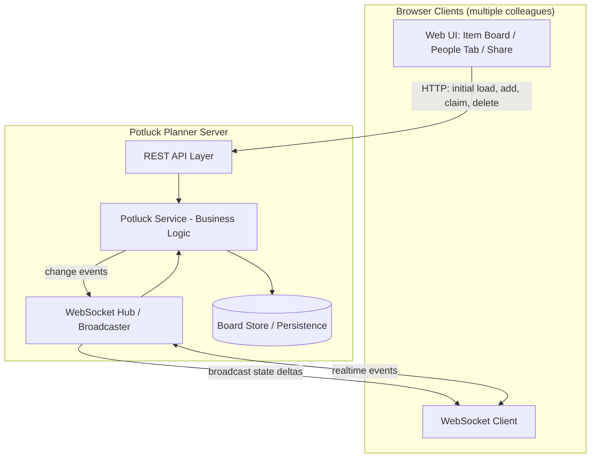
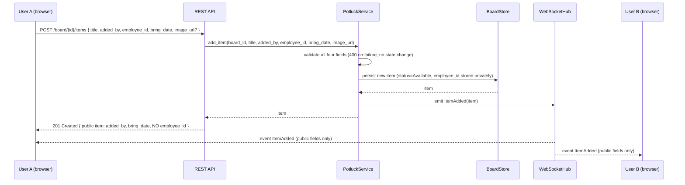
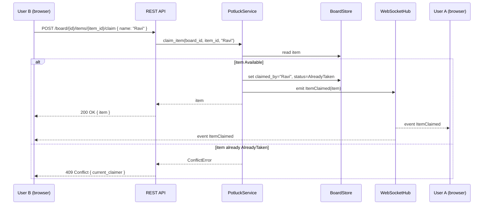
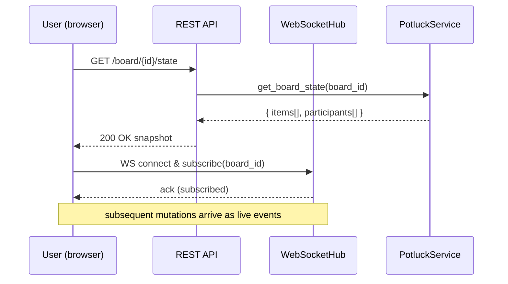
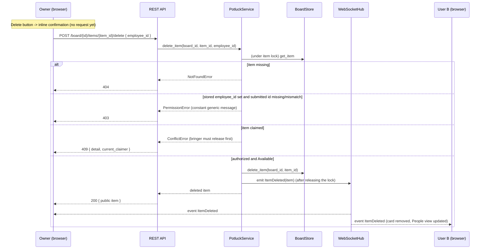
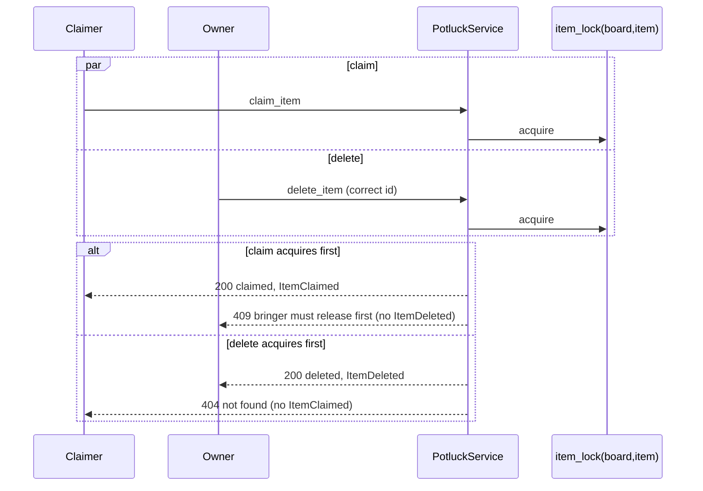

# Design Document: Realtime Potluck Planner

## Overview

The Realtime Potluck Planner is a web application that lets office colleagues coordinate a potluck by adding food items, claiming who brings what, and viewing a live, shared status of every item. The core problem it solves is duplication and waste: without a single shared view, multiple people bring the same dish while others go uncovered. By exposing a realtime, link-shareable board, every participant sees the current state instantly and can make informed choices.

The system is organized around two primary entities, **Items** (a dish to bring) and **Participants** (a named person). An item is either **Available** (no one has claimed it) or **Already Taken** (claimed by exactly one participant, shown as "Bringing: <name>"). The application pushes changes to all connected clients in realtime so that adding an item or claiming one is reflected live for everyone viewing the same shared board.

The design combines a **high-level view** (architecture, sequence diagrams, component interfaces, data models) with a **low-level view** (formal function specifications and algorithmic pseudocode) so the implementation can proceed directly from this document. Code examples use Python for the backend service layer; the realtime transport is WebSocket-based with a REST fallback for initial loads.

### Enhancement: adder details, Employee ID and delete (Requirements 9 to 14)

Adding an item now captures four mandatory values: the adder's name (`added_by`), the adder's employee id (`employee_id`), the food item `title`, and the `bring_date` (ISO `YYYY-MM-DD`). The name and the date are public and shown on the item card. The employee id is **private**: it is stored with the item and used for exactly one purpose, authorizing deletion of an item that is still Available. It is a lightweight ownership check, not authentication; the board link stays public and sign-in free.

The enhancement extends the current implementation minimally:

- `Item` gains three optional fields; `ChangeType` gains `ITEM_DELETED`.
- `item_to_dict` in `app/hub.py` stays the single serialization path and is an allow-list that never emits the employee id.
- `PotluckService` gains an async `delete_item`; `add_item` gains the new parameters and validation. `claim_item` and `unclaim_item` are unchanged.
- Both stores gain `delete_item`; the Postgres store gains an idempotent additive migration run on every startup.
- One new route (`POST .../items/{item_id}/delete`), a changed add body, and a sanitizing `RequestValidationError` handler.
- The client gains an `ItemDeleted` case in `applyEvent`, `deleteItem`/`addItem(payload)` in `api.js`, and the new form fields, card meta line, and inline delete confirmation in the UI.

Items created before the enhancement (**Legacy_Items**) have all three new fields `None`. They keep working for claim, release, list, and (without an employee id) delete.

Sections below keep the original text where nothing changed and are updated in place where it did; new material is marked "(Requirements 9 to 14)".

## Architecture



The server maintains the authoritative state of each **Board** (one shared potluck identified by a board id embedded in the shareable link). Mutations flow through the `PotluckService`, which validates and applies them to the `BoardStore`, then emits a change event. The `WebSocketHub` broadcasts that change to every client subscribed to the same board, producing realtime updates.

### Shareability Model

A board is addressable by a URL such as `https://<host>/board/{board_id}`. Anyone with the link joins the same board, loads current state over REST, and subscribes to live updates over WebSocket. **By explicit product decision, no authentication is used**; identity is a self-declared display name. This keeps joining frictionless for colleagues sharing a single office link.

> Security note: Because there is no authentication (by design), anyone with the link can add, claim, and unclaim items. This is acceptable for the trusted office context but means the board is effectively public to anyone who obtains the link. See Security Considerations.
>
> The Employee ID added by Requirements 9 to 14 does not change this model. It is a self-declared ownership hint for deleting one's own mistakes, it is stored server side only, and it is never returned to any client. Anyone who knows (or guesses) another person's employee id can delete that person's Available items; this is accepted for the trusted office context.

## Sequence Diagrams

### Flow 1: Add a Food Item (realtime fan-out)



### Flow 2: Claim an Item



### Flow 3: Client Join & Initial Sync



### Flow 4: Delete an Available Item (Requirements 12, 13)

The check order inside the per-item lock is part of the contract: not-found, then ownership (403), then claimed (409), then delete. Ownership is checked before the claimed state so a caller who does not hold the employee id cannot learn whether an item is claimed.



### Flow 5: Claim vs Delete race (Requirement 12.16)

Claim and delete take the same per-item lock, so they serialize and exactly one wins.



## Components and Interfaces

### Component 1: PotluckService

**Purpose**: Core business logic. Validates and applies all mutations, computes derived state (status, people grouping), and emits change events.

**Interface**:
```python
class PotluckService:
    def get_board_state(self, board_id: str) -> BoardState: ...
    async def add_item(
        self, board_id: str, title: str, added_by: str, employee_id: str,
        bring_date: str, image_url: str | None = None,
    ) -> Item: ...
    async def claim_item(self, board_id: str, item_id: str, name: str) -> Item: ...
    async def unclaim_item(self, board_id: str, item_id: str, name: str) -> Item: ...
    async def delete_item(
        self, board_id: str, item_id: str, employee_id: str | None
    ) -> Item: ...   # returns the deleted item (public fields are serialized by the caller)
    def list_people(self, board_id: str) -> list[PersonContribution]: ...
```

(In the code base the mutating methods are `async` because they `await` the hub broadcast; the original sketch showed them as plain `def`.)

**Responsibilities**:
- Enforce invariants (unique item ids, one claimer per item, non-empty titles/names).
- Validate the four add-item values (Requirements 9): trim, non-empty, `title <= 100`, `added_by <= 60`, `employee_id <= 30`, strict `YYYY-MM-DD` date. Validation always runs before any state change or broadcast.
- Transition item status between `Available` and `AlreadyTaken`.
- Authorize and apply deletion of Available items (Requirements 12, 13), using the stored employee id for that purpose and no other.
- Emit `ItemAdded`, `ItemClaimed`, `ItemUnclaimed`, `ItemDeleted` events to the hub.
- Derive the "People" view by grouping claimed items per participant name (deleted items are gone from the store, so they cannot appear).

### Component 2: BoardStore

**Purpose**: Persistence and retrieval of board state.

**Interface**:
```python
class BoardStore(Protocol):
    def get_board(self, board_id: str) -> Board | None: ...
    def create_board(self, board_id: str) -> Board: ...
    def save_item(self, board_id: str, item: Item) -> None: ...
    def get_item(self, board_id: str, item_id: str) -> Item | None: ...
    def list_items(self, board_id: str) -> list[Item]: ...
    def delete_item(self, board_id: str, item_id: str) -> bool: ...  # NEW: True if a row was removed
```

(`item_lock(board_id, item_id)` is provided by both concrete stores and used by the service, as today.)

**Responsibilities**:
- Store items and board metadata (in-memory map for MVP; Postgres for persistence).
- Persist `added_by`, `employee_id`, `bring_date` exactly as the service accepted them, and return `None` for them on legacy rows (Requirements 13, 14).
- Delete exactly one item by `(board_id, item_id)` and report whether anything was removed; leave all other items untouched and in the same relative order.
- Guarantee atomic read-modify-write on a single item (to make claim and delete conflict-safe). The per-item lock is process-local; the app must stay single-process (already required by the in-process hub).
- Never remove an entry from the per-item lock table on delete. A waiting claimer may still hold the old lock object; replacing it would let a later caller take a different lock and break claim/delete exclusivity. The leftover entry is a few bytes per deleted item.

### Component 3: WebSocketHub

**Purpose**: Manage client subscriptions per board and broadcast change events.

**Interface**:
```python
class WebSocketHub:
    def subscribe(self, board_id: str, connection: Connection) -> None: ...
    def unsubscribe(self, connection: Connection) -> None: ...
    def broadcast(self, board_id: str, event: ChangeEvent) -> None: ...
```

**Responsibilities**:
- Track active connections grouped by board id.
- Serialize `ChangeEvent` objects and push to all subscribers of the affected board.
- Clean up dropped connections.
- Own the **single public serialization function** `item_to_dict` (see below). `event_to_dict` already builds its `item` from it, so the `ItemDeleted` event has the same shape as every other event: `{type, board_id, item: {...public fields...}}`. The existing client code that reads `event.item` keeps working.

#### Public serialization (Requirements 10.5, 10.6, 11.1, 11.2)

`item_to_dict` in `app/hub.py` is the ONLY path that turns an `Item` into JSON. REST responses (add, claim, unclaim, delete), the board snapshot, the people view, and every WebSocket event all call it. It is an **allow-list**: each public field is named explicitly. A new private field added to `Item` later is therefore private by default, which a deny-list (`asdict` minus `employee_id`) would not guarantee.

```python
def item_to_dict(item: Item) -> dict[str, Any]:
    return {
        "id": item.id,
        "board_id": item.board_id,
        "title": item.title,
        "image_url": item.image_url,
        "claimed_by": item.claimed_by,
        "created_at": item.created_at,
        "status": item.status.value,
        "added_by": item.added_by,        # None for legacy items
        "bring_date": item.bring_date,    # "YYYY-MM-DD" or None for legacy items
        # employee_id is deliberately absent
    }
```

Defence in depth: `Item.employee_id` is declared with `repr=False`, so accidental logging of an `Item`, `BoardState` or `PersonContribution` does not print it either.

### Component 4: REST API Layer

**Purpose**: HTTP entry point for initial loads and mutations (also serves as a fallback when WebSockets are unavailable).

**Endpoints**:
| Method | Path | Purpose |
|--------|------|---------|
| GET | `/board/{board_id}/state` | Full snapshot (items + people) |
| POST | `/board/{board_id}/items` | Add a food item. Body `{title, added_by, employee_id, bring_date, image_url?}` |
| POST | `/board/{board_id}/items/{item_id}/claim` | Claim an item (body `{name}`, unchanged) |
| POST | `/board/{board_id}/items/{item_id}/unclaim` | Release a claim (body `{name}`, unchanged) |
| POST | `/board/{board_id}/items/{item_id}/delete` | Delete an Available item. Body `{employee_id?}` (NEW) |
| GET | `/board/{board_id}/people` | People view (grouped contributions) |

**Why `POST .../delete` and not `DELETE`**: the employee id must travel in the JSON body (never the URL, because URLs end up in access logs, browser history and proxies). Request bodies on HTTP `DELETE` are poorly supported by some proxies and clients, so a `POST` with a JSON body is the dependable choice. It also matches the existing `claim`/`unclaim` action-route style.

**Request models** use loosely typed optional fields so that missing or non-string values reach the service validator and produce the documented 400, instead of FastAPI's default 422:

```python
class AddItemRequest(BaseModel):
    title: Any = None
    added_by: Any = None
    employee_id: Any = None
    bring_date: Any = None
    image_url: Any = None

class DeleteItemRequest(BaseModel):
    employee_id: Any = None
```

The delete handler declares `body: DeleteItemRequest | None = None` and reads `employee_id` from the body only. It declares no query parameter, so an `employee_id` in the path or query string is ignored and counts as missing (Requirement 12.6). `NameRequest` (claim/unclaim) is unchanged.

**Delete error mapping** (success returns 200 with the public dict of the deleted item):

| Condition | Status | Body |
|-----------|--------|------|
| Item or board missing | 404 | `{detail}` |
| Stored employee id set, submitted id missing/blank/non-string/mismatch (checked before claimed state) | 403 | `{detail}` constant generic text |
| Item claimed (and id check passed or legacy item) | 409 | `{detail: "…the bringer must release it first", current_claimer}` |

**Sanitized validation handler (Requirements 11.1, 11.5)**. FastAPI's default `RequestValidationError` response (422) echoes the submitted input (`detail[].input`). A body containing an employee id would be reflected back to the caller and to any log or proxy that records error bodies. The API registers a handler that returns `400 {"detail": "The request was not valid. Please check the fields and try again."}` and never includes request values. This handler also covers malformed JSON and a non-object body. As a side effect, a missing or wrongly typed `name` on claim/unclaim now returns 400 instead of 422, which matches Requirement 7.6.

```python
@app.exception_handler(RequestValidationError)
async def _bad_request(_: Request, __: RequestValidationError) -> JSONResponse:
    return JSONResponse(status_code=400, content={"detail": SANITIZED_400})
```

### Component 5: Web UI

**Purpose**: Browser front-end rendering the item board, people tab, and share action.

**Views**:
- **Item Board**: grid of item cards (image, title, "Added by <name>" and the date as `D Mon YYYY`, "Bringing: <name>" or "Bringing: Not assigned", status badge green "Already Taken" / grey "Available"). Available cards also show a **Delete** button that opens an inline confirmation.
- **People Tab**: list of participants and the item(s) each is bringing.
- **Share**: copyable board link.
- **Landing tiles**: Add Food Items, Add Your Name, Live Item Status, Share with Office.

#### Add form (Requirements 9.8 to 9.10)

Fields, in order, all required except the image link: **Your name** (Added_By), **Employee ID**, **Food item**, **Date**, then the optional image link and the suggestion chips. Each field has a visible `<label>`, `required`, a per-field inline error element (`role="alert"`, linked with `aria-describedby`, `aria-invalid` set on error). Details:

- *Your name* is pre-filled from the saved claim name (`localStorage` key `potluck.name`) and stays editable. It follows the claim-name input only while the user has not edited it themselves (a `dirty` flag), so typing a different adder name is never overwritten.
- *Employee ID* is never written to `localStorage` or `sessionStorage`, has `autocomplete="off"` and `maxlength="30"`, and is cleared after a successful add. It is not rendered anywhere else.
- *Date* is `<input type="date" required>` pre-filled with `2026-10-12`. After a successful add the chosen date is kept for the next item.
- *Food item* `maxlength="100"` (was 80) to match the server limit.
- On a server error (400 and others) the message is shown next to the form and **every entered value is retained**; no card is added. The form is only reset on success.
- Client-side checks mirror the server (non-empty, lengths, `YYYY-MM-DD`) for fast feedback; the server remains authoritative.

#### Item card meta line (Requirements 10)

```
[image]  Title
         Added by <name>   ·  12 Oct 2026      <- only the parts that exist
         Bringing: <claimer | Not assigned>
         [Available | Already Taken]   [I'll bring this] [Delete]
```

- "Added by" is its own labelled element (`<span class="meta-label">Added by</span> <span class="meta-value">…</span>`), separate from the "Bringing:" line, so adder and claimer stay distinguishable even when the names are identical (10.4). The name is shown in full, not truncated (10.1).
- The date is formatted by **manual parsing** of the stored string, never through `new Date(...)`, so the viewer's time zone cannot shift the day (10.3). Invalid or missing input yields `null` and the part is omitted:

```javascript
const MONTHS = ["Jan","Feb","Mar","Apr","May","Jun","Jul","Aug","Sep","Oct","Nov","Dec"];
export function formatBringDate(iso) {
  const m = /^(\d{4})-(\d{2})-(\d{2})$/.exec(typeof iso === "string" ? iso : "");
  if (!m) return null;
  const month = Number(m[2]), day = Number(m[3]);
  if (month < 1 || month > 12 || day < 1 || day > 31) return null;
  return `${day} ${MONTHS[month - 1]} ${m[1]}`;   // "5 Oct 2026", no leading zero
}
```

- Legacy items (no `added_by` and/or no `bring_date`) omit only the missing part, with no placeholder or empty label (10.2). The `<time datetime="YYYY-MM-DD">` element wraps the formatted date.
- All user text (title, added_by, claimer) is written with `textContent` (10.7). `innerHTML` stays unused.

#### Delete flow (Requirements 12, 13)

- Available cards show a **Delete** button (`aria-label="Delete <title>"`). Claimed cards show none (12.2).
- Clicking it opens an **inline Delete_Confirmation panel** inside that card: a `<form>` naming the item (`Delete "<title>"?`), an **Employee ID** input with a visible label, an error line (`role="alert"`), and **Confirm delete** / **Cancel** buttons. No request is sent before Confirm (12.3), and Cancel sends nothing (12.4).
- For a legacy item (detection: item has no `added_by` and no `bring_date`) the label reads that the Employee ID may be left empty for items added before Employee IDs were introduced, and the form can be submitted with the input empty (13.7).
- Focus management: opening focuses the input; Cancel/Escape returns focus to that card's Delete button; success moves focus to the items summary (`tabindex="-1"`) because the card is gone; errors keep focus in the input.
- While a request is in flight, Confirm and Cancel are disabled and the input is read-only, so exactly one request is sent per confirmation (12.5). The request has a **10 second timeout** implemented with `AbortController` (12.15).
- Panel state (`{itemId, value, error, busy}`) lives in a single JS variable, not in the DOM, because `renderItems()` rebuilds the cards on every realtime event and would otherwise wipe what the user typed. The typed id is held only in that variable and the input; it is not persisted.
- If the item becomes claimed or disappears while the panel is open, the panel is dropped on the next render and a short message explains why.
- Errors are shown in the panel and the card stays: 403 shows the server's generic message, 409 shows the server message ("the bringer must release it first"; the usual "Already taken by X" wording is not used for delete), 404 shows the not-found message, timeout and network errors show their own text.

## Visual Theme & Branding

The UI follows the **PIRNAV "Potluck Week 2026"** festive theme (from the provided banner), evoking an Indian celebration of food, culture, and togetherness.

### Brand & Event Identity
- **Brand**: PIRNAV Software Solutions Pvt. Ltd.
- **Event title**: "Potluck Week 2026" with the tagline "A Celebration of Food, Culture, Tradition & Togetherness".
- **Event dates**: 12th – 16th October 2026 (displayed as an event banner/badge).
- **Closing tagline**: "Come together, share a little, celebrate a lot!".
- **Category motifs** (for landing/section iconography): Traditional Attire, Potluck, Fun Activities, Team Games.

### Color Palette
A warm, festive palette drawn from marigold flowers, brass vessels, and rangoli accents:

| Token | Hex (approx) | Usage |
|-------|--------------|-------|
| `--color-primary` | `#E8551E` (marigold orange) | Primary actions, highlights, logo accents |
| `--color-secondary` | `#9C1C3C` (deep maroon) | Banners, date pill, headers |
| `--color-accent-green` | `#2E7D4F` | "Already Taken" badge, success states |
| `--color-accent-yellow` | `#F2B705` (turmeric/gold) | Secondary highlights, brass accents |
| `--color-available` | `#8A8A8A` on `#ECECEC` | Grey "Available" badge |
| `--color-bg` | `#FFF8EE` (warm cream) | Page background |
| `--color-surface` | `#FFFFFF` | Cards, surfaces |
| `--color-text` | `#1F1A17` | Primary text |

### Typography & Visual Elements
- Bold, rounded, multi-color display lettering for the "Potluck" wordmark (echoing the banner), with a clean sans-serif for body text.
- Decorative festive accents (marigold garlands, diyas, rangoli borders) used sparingly as header/footer ornamentation so they do not distract from the functional item board.
- Status badges keep the sample-UI convention: green "Already Taken", grey "Available".

### Theme Application to Views
- **Landing**: PIRNAV logo, "Potluck Week 2026" banner with dates and tagline, and four feature tiles (Add Food Items, Add Your Name, Live Item Status, Share with Office) styled with the category motifs.
- **Item Board**: cards on warm cream background, festive accent borders, green/grey status badges.
- **People Tab**: participant list styled consistently with the warm palette.

### Theme additions for the enhancement (Requirements 9 to 12)

Only small additions to `static/css/theme.css`, reusing existing variables (no new colors):

```css
/* Added-by / date line on item cards */
.item-meta { margin: 0 0 0.25rem; font-size: 0.875rem; color: var(--color-text-muted); overflow-wrap: anywhere; }
.item-meta .meta-label { font-weight: 600; }
.item-meta .meta-sep { margin: 0 0.375rem; }

/* Delete confirmation panel inside a card */
.delete-confirm { display: grid; gap: 0.5rem; margin-top: 0.5rem; padding: 0.75rem;
  background: var(--color-bg); border: 1px solid var(--color-error); border-radius: var(--radius-md); }
.delete-confirm .delete-prompt { margin: 0; font-weight: 600; overflow-wrap: anywhere; }
.delete-confirm .delete-actions { display: flex; flex-wrap: wrap; gap: 0.5rem; }

/* Solid destructive button used only for "Confirm delete"; the card's Delete
   button reuses the existing .btn-danger-ghost */
.btn-danger { color: #fff; background: var(--color-error); border-color: var(--color-error); }
.btn-danger:hover:not(:disabled) { filter: brightness(0.92); }
```

The Delete button on the card uses the existing `btn btn-small btn-danger-ghost` classes; the add-form error lines reuse `.form-error`.

## Data Models

### Model: Item

```python
from dataclasses import dataclass, field
from enum import Enum

class ItemStatus(str, Enum):
    AVAILABLE = "Available"
    ALREADY_TAKEN = "Already Taken"

@dataclass
class Item:
    id: str                 # unique within board
    board_id: str
    title: str              # e.g., "Biryani"
    image_url: str | None   # optional food image
    claimed_by: str | None  # participant display name, or None
    created_at: float       # epoch seconds
    # --- Requirements 9 to 14; all None on Legacy_Items ---
    added_by: str | None = None      # public: who added the item (<= 60 chars, trimmed)
    employee_id: str | None = field(default=None, repr=False)  # PRIVATE: never serialized, never logged
    bring_date: str | None = None    # public: ISO "YYYY-MM-DD" string (not a date object)

    @property
    def status(self) -> ItemStatus:
        return ItemStatus.ALREADY_TAKEN if self.claimed_by else ItemStatus.AVAILABLE
```

The three new fields are appended with defaults, so every existing positional `Item(...)` construction (stores, hub tests) keeps working. `bring_date` is stored as the validated string rather than `datetime.date` so both stores round-trip it byte for byte (a `text` column in Postgres) and no time zone or formatting step can alter it.

**Validation Rules**:
- `title` must be non-empty after trimming whitespace and at most 100 characters.
- `added_by` must be non-empty after trimming and at most 60 characters.
- `employee_id` must be non-empty after trimming and at most 30 characters. Stored trimmed (original casing kept); compared with `strip().casefold()`.
- `bring_date` must match `^\d{4}-\d{2}-\d{2}$` (ASCII digits only) **and** parse with `datetime.date.fromisoformat`. The regex runs first because `fromisoformat` on Python 3.11+ also accepts other ISO shapes such as `20261012` or `2026-W41-1`, which Requirement 9.5 rejects; `fromisoformat` then rejects impossible dates such as `2026-02-30`. Any real calendar date is accepted, inside or outside 12 to 16 October 2026 (9.7).
- A Legacy_Item has `added_by`, `employee_id`, `bring_date` all `None`. An item is treated as legacy for deletion when `employee_id is None`.
- `id` must be unique within its board.
- `claimed_by`, when set, must be a non-empty trimmed name.
- `status` is derived, never stored independently (single source of truth = `claimed_by`).
- The three new fields are write-once: the service never changes them after creation, and the Postgres upsert does not update them (see Postgres store).

### Model: Board & BoardState

```python
@dataclass
class Board:
    id: str
    created_at: float

@dataclass
class PersonContribution:
    name: str
    items: list[Item]       # items this person is bringing

@dataclass
class BoardState:
    board_id: str
    items: list[Item]
    people: list[PersonContribution]
```

**Validation Rules**:
- `people` is derived purely from items where `claimed_by` is set, grouped by name (case-insensitive match, original casing preserved for display).

### Model: ChangeEvent (realtime payload)

```python
class ChangeType(str, Enum):
    ITEM_ADDED = "ItemAdded"
    ITEM_CLAIMED = "ItemClaimed"
    ITEM_UNCLAIMED = "ItemUnclaimed"
    ITEM_DELETED = "ItemDeleted"      # NEW (Requirement 12.12)

@dataclass
class ChangeEvent:
    type: ChangeType
    board_id: str
    item: Item                        # for ItemDeleted: the item as it was just before removal
```

Wire shape of every event, including `ItemDeleted` (the item carries public fields only; the client removes it by `item.id`):

```json
{"type": "ItemDeleted", "board_id": "b1",
 "item": {"id": "…", "board_id": "b1", "title": "Biryani", "image_url": null,
          "claimed_by": null, "created_at": 1760000000.0, "status": "Available",
          "added_by": "Asha", "bring_date": "2026-10-12"}}
```

### Postgres schema and migration (Requirements 13.4 to 13.6, 13.9, 14)

`potluck_items` gains three nullable `text` columns. Postgres adds a nullable column without a default as a catalog-only change, so no row is rewritten and the existing values are untouched.

```python
_MIGRATION_STATEMENTS = (
    "ALTER TABLE potluck_items "
    "ADD COLUMN IF NOT EXISTS added_by text, "
    "ADD COLUMN IF NOT EXISTS employee_id text, "
    "ADD COLUMN IF NOT EXISTS bring_date text",
)
_ITEM_COLUMNS = "id, board_id, title, image_url, claimed_by, created_at, added_by, employee_id, bring_date"

def _row_to_item(row) -> Item:
    return Item(id=row[0], board_id=row[1], title=row[2], image_url=row[3],
                claimed_by=row[4], created_at=float(row[5]),
                added_by=row[6], employee_id=row[7], bring_date=row[8])   # None on legacy rows
```

`ensure_schema` runs the existing `CREATE TABLE IF NOT EXISTS` / `CREATE INDEX IF NOT EXISTS` statements and then the migration, **all in one transaction** (the pooled connection context commits on success and rolls back on exception; Postgres DDL is transactional):

```pascal
PROCEDURE ensure_schema()
  OPEN transaction on a pooled connection
    EXECUTE "SET LOCAL lock_timeout = '10s'"            // fail fast instead of hanging a deploy
    EXECUTE "SELECT pg_advisory_xact_lock(<constant>)"  // serialize overlapping startups
    FOR each statement IN _SCHEMA_STATEMENTS DO EXECUTE statement END FOR
    FOR each statement IN _MIGRATION_STATEMENTS DO EXECUTE statement END FOR
  COMMIT                                                // any exception => ROLLBACK, error propagates
END PROCEDURE
```

- **Idempotent**: `ADD COLUMN IF NOT EXISTS` makes every run after the first a no-op; no duplicate columns, no data change (13.5).
- **Failure leaves data untouched**: a failing statement rolls back the whole transaction and the exception propagates out of the `PostgresBoardStore` constructor, so the app fails to start with a visible error instead of running on a half-migrated schema (13.9). The error text must not include the connection string (unchanged rule).
- **Transaction-scoped advisory lock** (`pg_advisory_xact_lock`, not the session-level variant) is safe behind Neon's PgBouncer transaction pooler and prevents two instances that overlap during a Render deploy from racing on DDL.
- **Rolling-deploy safe**: the new columns are additive and nullable, and the old code's `INSERT`/`SELECT` name their columns explicitly, so an old instance keeps working against the migrated table, and a rollback needs no schema change.
- `save_item`'s `INSERT` writes the three new columns; its `ON CONFLICT DO UPDATE` still updates only `title`, `image_url`, `claimed_by` (the new fields are write-once). `delete_item` uses a parameterised `DELETE FROM potluck_items WHERE board_id = %s AND id = %s` and returns `cursor.rowcount > 0`.

## Core Interfaces/Types

The service composes the components above:

```python
class PotluckService:
    def __init__(self, store: BoardStore, hub: WebSocketHub) -> None:
        self._store = store
        self._hub = hub
```

## Key Functions with Formal Specifications

### Function 1: add_item()

```python
async def add_item(
    self, board_id: str, title: str, added_by: str, employee_id: str,
    bring_date: str, image_url: str | None = None,
) -> Item
```

**Preconditions:**
- `board_id` identifies an existing board (or one is lazily created).
- `title`, `added_by`, `employee_id`, `bring_date` are each a `str` (a missing or non-string value is a validation failure, not a crash) whose trimmed value is non-empty.
- `len(title.strip()) <= 100`, `len(added_by.strip()) <= 60`, `len(employee_id.strip()) <= 30`.
- `bring_date.strip()` matches `^\d{4}-\d{2}-\d{2}$` (ASCII digits) and `date.fromisoformat` accepts it.
- `image_url` is `None` or a string.

**Postconditions:**
- On invalid input: raises `ValidationError` **before** the store is touched (no board creation, no item, no broadcast).
- Otherwise returns a new `Item` with a unique `id`, `claimed_by == None`, `status == Available`, and the trimmed `title`, `added_by`, `employee_id`, `bring_date`.
- The item is persisted and retrievable via `get_item`.
- Exactly one `ItemAdded` event is broadcast to subscribers of `board_id`; its payload contains `added_by` and `bring_date` but not `employee_id`.
- No existing item is modified.

**Loop Invariants:** N/A (no loops).

Validation helper (replaces `_require_non_empty` for add; claim/unclaim keep the current helper):

```python
_DATE_RE = re.compile(r"[0-9]{4}-[0-9]{2}-[0-9]{2}")   # fullmatch, ASCII digits only

def _require_text(value: Any, label: str, max_len: int) -> str:
    if not isinstance(value, str):
        raise ValidationError(f"{label} is required.")
    trimmed = value.strip()
    if not trimmed:
        raise ValidationError(f"{label} must not be empty.")
    if len(trimmed) > max_len:
        raise ValidationError(f"{label} must be at most {max_len} characters.")
    return trimmed

def _require_date(value: Any) -> str:
    text = _require_text(value, "Date", 10)
    try:
        if not _DATE_RE.fullmatch(text):
            raise ValueError
        datetime.date.fromisoformat(text)
    except ValueError:
        raise ValidationError("Date must be a real date in YYYY-MM-DD format.") from None
    return text
```

Validation messages name the field but never echo the submitted value, so an invalid employee id cannot leak through a 400 body.

### Function 2: claim_item()

```python
def claim_item(self, board_id: str, item_id: str, name: str) -> Item
```

**Preconditions:**
- `board_id`/`item_id` identify an existing item.
- `name.strip()` is non-empty.

**Postconditions:**
- If the item was `Available`: `claimed_by == name` (trimmed), `status == Already Taken`, and exactly one `ItemClaimed` event is broadcast.
- If the item was already `Already Taken`: raises `ConflictError`; state is unchanged and no event is broadcast.
- The read-modify-write is atomic per item (no two concurrent claims both succeed).

**Loop Invariants:** N/A.

### Function 3: unclaim_item()

```python
def unclaim_item(self, board_id: str, item_id: str, name: str) -> Item
```

**Preconditions:**
- Item exists and `item.claimed_by == name` (trimmed, case-insensitive).

**Postconditions:**
- `claimed_by == None`, `status == Available`.
- Exactly one `ItemUnclaimed` event is broadcast.
- If `item.claimed_by != name`, raises `PermissionError`; state unchanged.

**Loop Invariants:** N/A.

### Function 4: list_people()

```python
def list_people(self, board_id: str) -> list[PersonContribution]
```

**Preconditions:**
- `board_id` identifies an existing board.

**Postconditions:**
- Returns one `PersonContribution` per distinct claimer name.
- The union of all `PersonContribution.items` equals the set of claimed items on the board.
- No unclaimed item appears in any `PersonContribution`.

**Loop Invariants:**
- While iterating items, the accumulated grouping contains exactly the claimed items processed so far, correctly keyed by name.

Deleted items are removed from the store, so `list_people` needs no change: they cannot appear in any entry (Requirement 5.4). Legacy items are grouped exactly like any other item.

### Function 5: delete_item() (Requirements 12, 13)

```python
async def delete_item(
    self, board_id: str, item_id: str, employee_id: str | None
) -> Item
```

**Preconditions:**
- None on `employee_id`: it may be `None`, blank, non-string, or longer than 30 characters. The submitted value is only compared, never validated, so a legacy delete accepts any value (13.3) and a wrong value is a 403, not a 400.

**Postconditions (checked in exactly this order, all inside the per-item lock):**
1. Item missing: raises `NotFoundError`; state unchanged; no broadcast.
2. Stored `employee_id` is set and the submitted id (trimmed, casefolded; `None`, blank or non-string = missing) does not equal it: raises `PermissionError` with a **constant, generic message** that does not depend on the stored value (no prefix, length, or mask); state unchanged; no broadcast. This check comes **before** the claimed check so a caller who lacks the id cannot learn whether an item is claimed.
3. Item claimed (`claimed_by` set): raises `ConflictError(current_claimer=item.claimed_by, message="…the bringer must release it first")`; state unchanged; no broadcast. The claimer name is already public, so including it leaks nothing.
4. Otherwise the item is removed with `store.delete_item`; if that returns `False` the item vanished underneath us and `NotFoundError` is raised. After the lock is released, exactly one `ItemDeleted` event is broadcast and the removed `Item` is returned.
- Legacy items (`employee_id is None`): step 2 is skipped entirely.
- Every other item on the board is unchanged.
- Claim, unclaim and delete of the same item serialize on the same `item_lock`, so exactly one of a racing claim/delete wins (12.16). If the delete wins, a later claim finds no item and gets `NotFoundError` (404). The lock table entry for a deleted item is intentionally kept (see BoardStore).

**Loop Invariants:** N/A.

The id comparison uses `hmac.compare_digest` on the UTF-8 bytes of the two normalized strings. The board is public and an attacker can guess ids repeatedly, so avoiding an early-exit string compare is cheap hardening, even though network jitter makes a timing attack impractical here.

```python
def _norm_id(value: Any) -> str:
    return value.strip().casefold() if isinstance(value, str) else ""

def _ids_match(stored: str, submitted: Any) -> bool:
    s = _norm_id(submitted)
    return bool(s) and hmac.compare_digest(_norm_id(stored).encode(), s.encode())
```

## Algorithmic Pseudocode

### Add Item Algorithm

```pascal
ALGORITHM addItem(board_id, title, added_by, employee_id, bring_date, image_url)
INPUT: board_id, title, added_by, employee_id, bring_date, image_url
OUTPUT: item of type Item

BEGIN
  // 1. Validate everything first. Any failure raises ValidationError here,
  //    before the store is touched and before any broadcast.
  title       <- requireText(title,       "Item title",  100)
  added_by    <- requireText(added_by,    "Your name",    60)
  employee_id <- requireText(employee_id, "Employee ID",  30)
  bring_date  <- requireDate(bring_date)        // regex ^\d{4}-\d{2}-\d{2}$ AND date.fromisoformat
  ASSERT image_url = NULL OR image_url is a string

  board <- store.get_board(board_id)
  IF board = NULL THEN
    board <- store.create_board(board_id)
  END IF

  item <- new Item(
    id: generateUniqueId(),
    board_id: board_id,
    title: title,
    image_url: image_url,
    claimed_by: NULL,
    created_at: now(),
    added_by: added_by,
    employee_id: employee_id,     // private
    bring_date: bring_date
  )

  store.save_item(board_id, item)

  ASSERT item.status = Available
  hub.broadcast(board_id, ChangeEvent(ITEM_ADDED, board_id, item))   // serializer drops employee_id

  RETURN item
END
```

**Preconditions:** none beyond types; invalid input is reported, not asserted.
**Postconditions:** on invalid input nothing changed and nothing broadcast; otherwise a new Available item with all four trimmed values persisted and a single ItemAdded broadcast.
**Loop Invariants:** N/A.

### Delete Item Algorithm (conflict-safe, ownership-checked)

```pascal
ALGORITHM deleteItem(board_id, item_id, employee_id)
INPUT: board_id, item_id, employee_id (may be NULL, blank, or any value)
OUTPUT: item of type Item (the deleted item)

BEGIN
  BEGIN ATOMIC per item_id
    item <- store.get_item(board_id, item_id)
    IF item = NULL THEN
      RAISE NotFoundError                                   // 404
    END IF

    IF item.employee_id <> NULL THEN                        // legacy items skip this block
      IF NOT idsMatch(item.employee_id, employee_id) THEN
        RAISE PermissionError("You are not allowed to delete this item.")   // 403, constant text
      END IF
    END IF

    IF item.claimed_by <> NULL THEN
      RAISE ConflictError(current_claimer: item.claimed_by,
                          message: "This item has been claimed. The bringer must release it first.")   // 409
    END IF

    removed <- store.delete_item(board_id, item_id)
    IF removed = false THEN
      RAISE NotFoundError
    END IF
  END ATOMIC

  hub.broadcast(board_id, ChangeEvent(ITEM_DELETED, board_id, item))   // exactly one, after the lock
  RETURN item
END
```

**Preconditions:** none on `employee_id`.
**Postconditions:** on any raise, store and subscribers are untouched; on success exactly one item is gone, every other item is unchanged, and exactly one ItemDeleted is broadcast.
**Loop Invariants:** N/A (the critical section is straight-line code).

### Claim Item Algorithm (conflict-safe)

```pascal
ALGORITHM claimItem(board_id, item_id, name)
INPUT: board_id, item_id, name
OUTPUT: item of type Item

BEGIN
  ASSERT trim(name) <> ""

  BEGIN ATOMIC per item_id
    item <- store.get_item(board_id, item_id)
    IF item = NULL THEN
      RAISE NotFoundError
    END IF

    IF item.claimed_by <> NULL THEN
      RAISE ConflictError(current_claimer: item.claimed_by)
    END IF

    item.claimed_by <- trim(name)
    store.save_item(board_id, item)
  END ATOMIC

  ASSERT item.status = AlreadyTaken
  hub.broadcast(board_id, ChangeEvent(ITEM_CLAIMED, board_id, item))

  RETURN item
END
```

**Preconditions:** item exists; trimmed name non-empty.
**Postconditions:** on success, item claimed and single ItemClaimed broadcast; on conflict, state unchanged and no broadcast.
**Loop Invariants:** N/A (atomic section guards the critical read-modify-write).

### Build People View Algorithm

```pascal
ALGORITHM listPeople(board_id)
INPUT: board_id
OUTPUT: contributions (list of PersonContribution)

BEGIN
  items <- store.list_items(board_id)
  groups <- empty map  // key: lowercase(name) -> PersonContribution

  FOR each item IN items DO
    ASSERT groupsContainOnlyClaimedProcessedSoFar(groups)

    IF item.claimed_by <> NULL THEN
      key <- lowercase(item.claimed_by)
      IF groups[key] = NULL THEN
        groups[key] <- new PersonContribution(name: item.claimed_by, items: [])
      END IF
      groups[key].items.append(item)
    END IF
  END FOR

  RETURN values(groups)
END
```

**Preconditions:** board exists.
**Postconditions:** one entry per distinct claimer; only claimed items grouped.
**Loop Invariants:** after processing k items, `groups` contains exactly the claimed items among the first k, keyed by claimer name.

## Client Changes (Requirements 12.13, 12.15, 9, 10)

### `static/js/realtime.js`: `applyEvent` handles `ItemDeleted`

```javascript
case "ItemDeleted":
  if (idx !== -1) next.splice(idx, 1);   // idempotent: no-op when the id is absent
  break;
```

`applyEvent` still returns a new array and never mutates its input. `BoardClient` buffering, the double snapshot around the subscribe ack, ordering, and reconnect logic are unchanged. `derivePeople` works from the items list, so a removed item disappears from the People view and from the summary counts on the next render without further code.

### `static/js/api.js`

```javascript
// addItem now takes one payload object; image_url is optional and sent as null when empty
addItem: ({ title, added_by, employee_id, bring_date, image_url }) =>
  request("/items", { method: "POST",
    body: { title, added_by, employee_id, bring_date, image_url: image_url || null } }),

// employee_id travels in the JSON body only; 10 s timeout via AbortController
deleteItem: (itemId, employeeId) =>
  request(`/items/${encodeURIComponent(itemId)}/delete`,
    { method: "POST", body: { employee_id: employeeId ?? "" }, timeoutMs: 10000 }),
```

`request()` gains an optional `timeoutMs`: it creates an `AbortController`, aborts after the timeout, clears the timer in `finally`, and maps an abort to an `ApiError` with a distinct "The request timed out. Please try again." message (status 0), separate from the existing "Can't reach the server" message. `detailToMessage` already reads string `detail` values, which covers the sanitized 400.

### `static/js/app.js`

- `renderItemCard` adds the meta line (`formatBringDate`, "Added by" element) and, for Available items, a Delete button next to the claim button.
- The delegated click handler gets `delete`, `cancel-delete` actions; the confirmation `<form>` has a `submit` handler (so Enter confirms). `findFocusTarget` is widened to `[data-action]` so focus inside the confirmation survives re-renders.
- The add-form submit handler validates, calls `api.addItem({...})`, retains values on error, and clears only title, image, and employee id on success.
- `errorMessage` is kept for claim/unclaim; a separate `deleteErrorMessage` returns the server message verbatim for 409 so the "Already taken by X" wording is not used.

## Example Usage

```python
# Wire up components
store = InMemoryBoardStore()
hub = WebSocketHub()
service = PotluckService(store, hub)

board_id = "office-diwali-2025"

# Example 1: Someone adds an item (starts Available)
biryani = await service.add_item(
    board_id, title="Biryani", added_by="Asha", employee_id="E1042",
    bring_date="2026-10-12", image_url="https://img/biryani.jpg",
)
assert biryani.status == ItemStatus.AVAILABLE
assert biryani.claimed_by is None   # UI shows "Bringing: Not assigned"
assert item_to_dict(biryani)["added_by"] == "Asha"
assert "employee_id" not in item_to_dict(biryani)

# Example 2: Ravi claims it -> becomes Already Taken (name only, no employee id)
claimed = await service.claim_item(board_id, biryani.id, name="Ravi")
assert claimed.status == ItemStatus.ALREADY_TAKEN
assert claimed.claimed_by == "Ravi"  # UI shows "Bringing: Ravi" + green badge

# Example 3: A second claim on the same item is rejected
try:
    await service.claim_item(board_id, biryani.id, name="Meera")
except ConflictError as e:
    print("Already taken by:", e.current_claimer)  # "Ravi"

# Example 4: People view groups items by claimer
sweets = await service.add_item(board_id, "Gulab Jamun", "Asha", "E1042", "2026-10-13")
await service.claim_item(board_id, sweets.id, name="Ravi")
people = service.list_people(board_id)
# people -> [ PersonContribution(name="Ravi", items=[Biryani, Gulab Jamun]) ]

# Example 5: Delete rules
snacks = await service.add_item(board_id, "Snacks", "Asha", "E1042", "2026-10-14")
try:
    await service.delete_item(board_id, snacks.id, "WRONG")
except PermissionError:
    pass                                              # 403, constant message
deleted = await service.delete_item(board_id, snacks.id, "  e1042 ")   # trimmed, case-insensitive
assert deleted.id == snacks.id                        # one ItemDeleted broadcast
try:
    await service.delete_item(board_id, biryani.id, "E1042")
except ConflictError:
    pass                                              # 409: Ravi must release it first

# Example 6: Legacy item (no stored employee id) can be deleted without one
legacy = Item("L1", board_id, "Old dish", None, None, 1.0)   # added_by/employee_id/bring_date = None
store.save_item(board_id, legacy)
await service.delete_item(board_id, "L1", None)
```

## Correctness Properties

These are the invariants the implementation must uphold (universal quantification over all boards, items, and operation sequences):

> Note: Requirement references below are aligned with the finalized `requirements.md` derived from this design.

### Property 1: Status consistency
For every item `i`, `i.status == Already Taken` if and only if `i.claimed_by` is a non-empty name; otherwise `i.status == Available`.

**Validates: Requirements 4.1**

### Property 2: Single claimer
For every item `i`, at most one participant appears as `claimed_by` at any time.

**Validates: Requirements 2.1**

### Property 3: Claim exclusivity (no double booking)
For any two concurrent `claim_item` calls on the same Available item, exactly one succeeds and the other raises `ConflictError`; the final `claimed_by` is the successful caller's name.

**Validates: Requirements 2.2**

### Property 4: Add preserves others
`add_item` creates exactly one new Available item and modifies no existing item.

**Validates: Requirements 1.1**

### Property 5: People-view completeness and soundness
The multiset of items across all `PersonContribution` entries equals exactly the set of claimed items on the board, with no unclaimed item present.

**Validates: Requirements 5.1**

### Property 6: Realtime fan-out
Every successful mutation (`add_item`, `claim_item`, `unclaim_item`, `delete_item`) results in exactly one `ChangeEvent` broadcast to all current subscribers of that board, and no event for failed mutations (see also Property 12).

**Validates: Requirements 3.1, 3.4**

### Property 7: Snapshot/event convergence
A client applying the initial snapshot then all subsequent events arrives at the same board state as a client that loads a fresh snapshot later (eventual consistency).

**Validates: Requirements 3.3**

### Property 8: Unclaim ownership
`unclaim_item(name)` succeeds only when `item.claimed_by` matches `name`; afterwards the item is Available again.

**Validates: Requirements 2.3**

> Properties 9 to 16 cover Requirements 9 to 14. They are numbered after the original eight; the original numbering is unchanged.

### Property 9: Add requires four valid fields
For any `(title, added_by, employee_id, bring_date)` input, `add_item` succeeds if and only if all four are strings that are non-empty after trimming, with `len(title) <= 100`, `len(added_by) <= 60`, `len(employee_id) <= 30` (trimmed lengths), and `bring_date` is a real calendar date in strict `YYYY-MM-DD` form (any date, inside or outside Potluck Week). On success the stored item holds the four **trimmed** values. On any failure `ValidationError` is raised, the store is identical to before (including no lazily created board), and no event is broadcast. Counter-examples that must be rejected: `2026-02-30`, `2026-10-5`, `20261012`, `2026-W41-1`, non-ASCII digits, a missing or `None` field, a non-string value (number, list, object).

**Validates: Requirements 9.1, 9.2, 9.3, 9.4, 9.5, 9.6, 9.7, 9.11**

### Property 10: Employee ID never leaves the server
For any operation sequence and any employee id `e` used in it (stored or submitted), no REST response body (snapshot, people view, add, claim, unclaim, delete, and every error body including 400, 403, 404, 409), no WebSocket message, and no `item_to_dict` output contains a key named like `employee_id` (any casing) or any string value equal to `e` under trimmed, case-insensitive comparison. Tests use distinctive ids (for example `EMP-` plus a random token) so that a substring scan of the raw body text is also meaningful. This includes a 400 response produced from a body that contains `e`, so the sanitized `RequestValidationError` handler is covered.

**Validates: Requirements 10.5, 10.6, 11.1, 11.2, 11.5**

### Property 11: Delete authorization
For any item `i` and any submitted id `s` (including `None`, blank, whitespace, non-string, longer than 30 characters):
- if `i` is missing, delete raises `NotFoundError` whatever `s` is;
- else if `i.employee_id` is set and `s` does not equal it after trimming and casefolding, delete raises `PermissionError` whether or not `i` is claimed, with a message identical for every stored id and every `s`;
- else if `i` is claimed, delete raises `ConflictError` (this includes legacy items, and owners with the right id);
- else delete succeeds.
A legacy item (`employee_id is None`) is deletable with any `s`. A rejected delete leaves the item and board unchanged.

**Validates: Requirements 12.7, 12.8, 12.9, 12.10, 12.11, 13.3, 13.8, 11.5**

### Property 12: Delete removes exactly one item and broadcasts exactly once
A successful `delete_item` removes exactly the targeted item, leaves every other item unchanged and in the same relative order, and broadcasts exactly one `ItemDeleted` event whose `item.id` is the deleted id. A failed delete (404, 403, 409) changes nothing and broadcasts nothing. The deleted id is absent from `get_item`, `list_items`, the snapshot, and the people view; deleting it again raises `NotFoundError`.

**Validates: Requirements 12.7, 12.12, 3.1, 3.4, 5.4**

### Property 13: Claim and delete are mutually exclusive under concurrency
For any Available item with a known owner id, when a `claim_item` and a `delete_item` (with the correct id) run concurrently, exactly one succeeds: either claim succeeds and delete raises `ConflictError`, or delete succeeds and claim raises `NotFoundError`. Exactly one of `ItemClaimed` / `ItemDeleted` is broadcast, and the final store state matches the winner (claimed item present, or item absent).

**Validates: Requirements 12.16**

### Property 14: Snapshot + events convergence, including deletion
A client that applies a snapshot and then every subsequent event (`ItemAdded`, `ItemClaimed`, `ItemUnclaimed`, `ItemDeleted`) in order, using `applyEvent`, ends with the same item set as a fresh snapshot taken at the same later time. `applyEvent` for `ItemDeleted` removes the item by id, is a no-op when the id is absent, and never mutates its input. Buffered events replayed over a snapshot taken after the subscribe ack also converge, even when the snapshot already reflects a later deletion: a replayed `ItemClaimed` for an item the snapshot lacks re-adds it only until the already-ordered `ItemDeleted` removes it.

**Validates: Requirements 3.3, 12.13**

### Property 15: Store parity and migration idempotence
For any sequence of add, claim, unclaim, and delete operations applied to `InMemoryBoardStore` and `PostgresBoardStore` from the same empty board, the returned item fields (ignoring generated ids and `created_at`), the error category of every failed operation (validation, not-found, conflict, forbidden), and the final snapshot (items in the same order with the same title, image, claimer, status, `added_by`, `bring_date`, and the same grouped people) are identical. `delete_item` returns `True` once and `False` afterwards. Running `ensure_schema` any number of times on any schema state (old or new) succeeds, creates no duplicate column, and leaves row count and every column value unchanged; a migrated legacy row reads back with `added_by`, `employee_id`, `bring_date` equal to `None` and its other columns equal to their pre-migration values.

**Validates: Requirements 13.4, 13.5, 13.6, 13.9, 14.1, 14.2, 14.3, 14.4, 14.5**

### Property 16: People view excludes deleted items
For any operation sequence containing deletes, the multiset of items in `list_people` equals the set of claimed items that currently exist; no deleted item appears. Since only Available items can be deleted, deleting never changes any person's entry.

**Validates: Requirements 5.1, 5.4**

## Error Handling

### Error Scenario 1: Claim on an already-claimed item
**Condition**: Two users claim the same Available item nearly simultaneously.
**Response**: The atomic section lets the first write win; the second receives `409 Conflict` with the current claimer's name.
**Recovery**: Loser's UI refreshes the card from the broadcast `ItemClaimed` event showing the actual claimer; user can pick a different item.

### Error Scenario 2: Invalid input (empty or invalid title, name, added-by, employee id, or date)
**Condition**: any of `title`, `added_by`, `employee_id`, `bring_date`, or a claim/release `name` is missing, not a string, empty after trimming, over its length limit (title 100, added_by 60, employee_id 30), or (for the date) not a real `YYYY-MM-DD` date.
**Response**: `400 Bad Request` with a validation message that names the field but never echoes the submitted value; no state change, no broadcast.
**Recovery**: UI shows the message next to the form, keeps everything the user typed, adds no card, and focuses the first offending field.

### Error Scenario 3: Item or board not found
**Condition**: Operation references a non-existent item id.
**Response**: `404 Not Found`.
**Recovery**: UI re-syncs via `GET /board/{id}/state`.

### Error Scenario 4: WebSocket disconnect
**Condition**: A client's realtime connection drops.
**Response**: Client detects closure and attempts reconnect with exponential backoff; on reconnect it re-fetches the snapshot then resubscribes.
**Recovery**: Snapshot/event convergence (property 7) guarantees the client catches up to current state.

### Error Scenario 5: Unauthorized unclaim
**Condition**: A user tries to unclaim an item claimed by someone else.
**Response**: `403 Forbidden`; state unchanged.
**Recovery**: UI shows that only the claimer can release the item.

### Error Scenario 6: Delete with a wrong or missing Employee ID
**Condition**: The item has a stored employee id and the submitted id is missing, blank, or differs after trimming and case-insensitive comparison. This is checked before the claimed state.
**Response**: `403 Forbidden` with one constant, generic message that does not depend on the stored id (no prefix, suffix, mask, or length). Item unchanged, no event.
**Recovery**: The confirmation panel shows the message, keeps the card and the typed value, and keeps focus in the input.

### Error Scenario 7: Delete of a claimed item
**Condition**: The item is claimed and the caller passed the ownership check (matching id, or a legacy item).
**Response**: `409 Conflict` with a message that the bringer must release the item first, plus `current_claimer` (already public). Item unchanged, no event.
**Recovery**: The panel shows the message. The card remains and its Delete button disappears as soon as the claim arrives over the socket.

### Error Scenario 8: Request body fails FastAPI validation
**Condition**: Malformed JSON, a non-object body, or a body that fails framework validation on any route (for example a missing `name` on claim).
**Response**: `400 Bad Request` with the fixed text "The request was not valid. Please check the fields and try again." The framework's default 422 body is never returned because it echoes the submitted input, which could include an employee id.
**Recovery**: UI shows the message; nothing changed.

### Error Scenario 9: Delete request times out or fails to reach the server
**Condition**: No response within 10 seconds, or a network error.
**Response**: The client aborts the request (`AbortController`) and shows a timeout or connection message in the panel. The card stays. The request may or may not have reached the server.
**Recovery**: The user can retry. If the first attempt did succeed, the `ItemDeleted` event removes the card, and a retry would get a 404 that is shown without harm.

### Error Scenario 10: Postgres migration fails at startup
**Condition**: `ensure_schema` raises (connectivity, permissions, lock timeout).
**Response**: The transaction rolls back, existing rows and values are untouched, and the exception propagates so the app fails to start with a visible error. The connection string is not included in the message.
**Recovery**: Fix the cause and restart; the migration is safe to re-run.

### Error mapping summary

| Operation | Condition | Status | Broadcast |
|-----------|-----------|--------|-----------|
| add | any of the four fields missing/invalid/over limit | 400 | none |
| add / claim / unclaim / delete | body fails framework validation (sanitized) | 400 | none |
| claim / unclaim / delete | item or board missing | 404 | none |
| claim | item already claimed | 409 + `current_claimer` | none |
| unclaim | not the current claimer | 403 | none |
| delete | stored id set and submitted id missing/blank/mismatch (checked first, claimed or not) | 403 (constant message) | none |
| delete | item claimed, ownership passed or legacy item | 409 (bringer must release first) + `current_claimer` | none |
| delete | racing claim won | 409 | none (the claim's event only) |
| claim | racing delete won | 404 | none (the delete's event only) |
| delete | authorized and Available | 200 public item | one `ItemDeleted` |

## Testing Strategy

### Unit Testing Approach
- Validate `add_item`, `claim_item`, `unclaim_item`, `delete_item`, `list_people` against their pre/postconditions.
- Cover status derivation, trimming, and empty-input rejection.
- Verify a single broadcast per successful mutation and zero on failures (using a fake hub).
- **Add validation** (Req 9): each of the four fields missing, `None`, non-string, blank, over the limit (101/61/31 characters pass at 100/60/30), whitespace-padded values stored trimmed, dates `2026-02-30`, `2026-10-5`, `20261012`, `2026-W41-1`, `2026-1-05`, non-ASCII digits rejected, `2025-01-01` and `2030-12-31` accepted (outside Potluck Week).
- **Delete** (Req 12, 13): the full decision table (missing / wrong id / right id / padded and differently cased id / blank id / `None` / over-30-character id) crossed with (Available / claimed) crossed with (new / legacy item). Assert the 403-before-409 order (a claimed item with a wrong id gives 403) and that the 403 message is identical for different stored ids. A rejected delete leaves the store and the fake hub untouched.
- **Serialization** (Req 10, 11): `item_to_dict` has exactly the expected key set, includes `added_by`/`bring_date`, has no `employee_id`; legacy items give `None` values; `repr(Item)` does not contain the employee id.
- **Stores** (`test_store.py`): `delete_item` returns `True` then `False`, preserves the order of the remaining items, does not touch other boards; the new fields round-trip through `save_item`/`get_item`/`list_items`.
- **Existing tests**: call sites that used `add_item(board, title)` or `add_item(board, title, image_url)` must move to the new signature. A small test helper (for example `add(service, board, title="Dish", *, by="Asha", emp="E1", date="2026-10-12", image=None)`) keeps those edits mechanical. Direct `Item(...)` constructions keep working because the new fields have defaults.
- **Client logic** (if a JS test runner is added later; otherwise covered by the manual checklist): `formatBringDate` (`2026-10-05` gives `5 Oct 2026`, invalid gives `null`, no time-zone shift when `TZ` differs) and `applyEvent` for `ItemDeleted` (removes, no-op when absent, input not mutated).

### Property-Based Testing Approach
Generate random sequences of add/claim/unclaim/**delete** operations and assert the Correctness Properties hold on the resulting state.
- Property 1 (status consistency), Property 2 (single claimer), Property 5 (people-view soundness), Property 16 (people view excludes deleted) are strong candidates for property tests over random op sequences.
- Property 3 (claim exclusivity) tested with concurrent claim simulations. Property 13 is the same harness with one claim racing one correct-id delete (`asyncio.gather`, repeated, with the winner derived from the results).
- **Generator extension**: the existing op-sequence generator in `tests/test_service_properties.py` gains `("delete", target_index, submitted_id)` where `submitted_id` is drawn from: the item's real id, the real id with different case and padding, a wrong id, `None`, blank, and an over-length string. The add op carries generated `(title, added_by, employee_id, bring_date)`. A pure-Python reference model (dict of items with the rules of Property 11) is updated alongside, and after every step the real state, the raised error category, and the recorded hub events are compared to the model (Properties 9, 11, 12).
- **Property 9** uses separate strategies: valid values near their limits plus an "invalid" strategy that mutates exactly one field at a time (empty, whitespace, `None`, a number, too long, a malformed date). For dates, `st.dates()` formatted with `isoformat()` must be accepted and arbitrary text must be accepted only if it equals `date.isoformat()` of some date.
- **Property 10** runs the op sequence through the HTTP API (`TestClient`) and a recording hub. It scans every response body and every broadcast payload with a recursive walk over keys and string values and also a substring scan for a distinctive random id (`"EMP-" + token`).
- **Property 14** extends the existing convergence test: the op generator includes deletes, the client model applies `applyEvent` semantics (a Python port in the test, mirrored by the JS function), and the result is compared with a fresh snapshot at several cut points, including a replay with a snapshot taken mid-sequence.
- **Property 15** (store parity): one generator produces an op list; a runner executes it against a store through `PotluckService` and returns a normalized trace (per op: `("ok", item fields without id/created_at)` or `("err", category)`, with generated ids mapped to creation indexes) plus the final snapshot. The test asserts `trace(memory) == trace(postgres)`. The in-memory run always executes; the comparison with Postgres is skipped without `DATABASE_URL`.

**Property Test Library**: Hypothesis (Python).

### API Testing Approach (`tests/test_api.py`, `TestClient`)
- Add: 201 with `added_by`, `bring_date`, no `employee_id`; 400 for each invalid field and for missing keys, wrong types (`{"title": 5}`), malformed JSON, and a non-object body; the 400 body never contains the submitted values.
- Delete: 200 and public item for the owner (case/space-insensitive id); 403 wrong or missing id (including `{}`, no body, id in the query string, id in the path); 409 for claimed with correct id and for claimed legacy; 403 for claimed with wrong id; 404 unknown item and unknown board with any id; legacy delete with no body, empty, whitespace, and a 31-plus character id.
- Constant message: the 403 bodies for two different stored ids and two different submitted ids are byte-identical.
- Claim/unclaim routes still behave as before (200/409/403/404/400), the only change being 400 instead of 422 for body-shape errors.
- Snapshot and people responses contain `added_by`/`bring_date` and no employee id; legacy items show `null` for both.

### Integration Testing Approach
- Spin up the REST + WebSocket server, connect two clients to the same board, perform add/claim on one, and assert the other receives the matching `ChangeEvent` and converges to the same snapshot.
- **WebSocket `ItemDeleted`** (`tests/test_realtime_integration.py`): two sockets on one board; add via REST, delete via REST; both sockets receive exactly one `ItemDeleted` with the same shape as other events (`{type, board_id, item}`), the item id matches, no `employee_id` key or value appears in any frame, and a fresh snapshot lacks the item. A failed delete (403, 409, 404) sends no frame. A socket on a different board receives nothing.

### Postgres Testing Approach (`tests/test_pg_store.py`, `tests/test_store_parity.py`)
All Postgres tests keep the existing `pytest.mark.skipif(not os.getenv("DATABASE_URL"))` guard, use unique random board ids, and delete only their own rows (never `TRUNCATE`/`DROP` on shared tables).
- New columns round-trip: `added_by`, `employee_id`, `bring_date` are returned unchanged, including from a second `PostgresBoardStore` instance (restart simulation).
- `delete_item`: `True` then `False`, other items and other boards untouched, order preserved, parameterised statement (a title/id containing quotes does not break it).
- Re-saving an item (claim then unclaim) does not overwrite the three write-once columns.
- **Migration test**: use a throwaway schema (a random `search_path` schema created for the test, or a randomly named table set) so the shared tables are never dropped. Create the **old** `potluck_items` schema by hand (only the original columns), insert a legacy row, record row count and column values, then run `ensure_schema`. Assert: the three columns exist; the row count and every original value are unchanged; the legacy row reads back through the store with the three new fields `None`; running `ensure_schema` a second and third time raises nothing, creates no duplicate column, and changes no data; a store built on the migrated table can add a new-style item and delete the legacy one.
- **Failure test**: make the migration statement fail (for example, run it with a role or table that rejects the `ALTER`, or monkeypatch one statement to an invalid one) and assert the exception propagates and the pre-existing rows and columns are unchanged (transaction rollback).
- **Parity**: the shared op-sequence runner (Property 15) runs against both stores.

### Manual UI Checklist
No browser test runner exists, so the UI behavior is verified manually: required fields and inline errors, retained values after a 400, date pre-fill `2026-10-12`, card meta line for new and legacy items, `<` `>` `&` in names rendered literally, Delete visibility (Available only), confirmation panel flow (no request before Confirm, Cancel sends nothing, legacy label, focus handling, 10 s timeout by throttling), live removal in a second browser tab, People view update, and that the employee id appears nowhere in the DOM or in `localStorage`.

## Performance Considerations

- Expected scale is a single office board with tens of items and tens of concurrent viewers; in-memory store with per-board broadcast is sufficient.
- Broadcasts send compact per-item deltas (`ChangeEvent`), not full snapshots, to minimize bandwidth.
- Per-item locking (atomic section) keeps the critical region tiny, so claim and delete contention does not block unrelated items.
- `ItemDeleted` is a compact per-item event like the others; the 2 second delivery target (Requirement 12.12) is easily met by a direct in-process broadcast.
- The three new columns are nullable `text`; adding them is a metadata-only change. The startup `ALTER TABLE ... IF NOT EXISTS` takes a brief table lock, bounded by `lock_timeout`, on a table of tens of rows.

## Security Considerations

- MVP has no authentication; anyone with the board link can read and mutate. Acceptable for trusted office use but documented as a known limitation.
- Input is validated and trimmed server-side to prevent empty/malformed data.
- `image_url` should be validated/sanitized and rendered safely to avoid injection via crafted URLs.
- Board ids embedded in links should be unguessable (random tokens) so boards are not trivially enumerable.
- Rate limiting on mutation endpoints is recommended to prevent spam/abuse via the public link. With the Employee ID this also limits brute-force guessing of ids on the delete route; the id space is small and ids are low-entropy, so this is a speed bump, not a guarantee.

### Employee ID handling (Requirements 11, 12)

- **Not authentication.** The Employee ID is a lightweight ownership hint. Anyone who knows an id can delete that person's Available items; the damage is bounded because claimed items cannot be deleted and the board is a trusted-office tool.
- **Allow-list serialization.** `item_to_dict` is the only serializer and names each public field; `employee_id` is never in the list. Property 10 tests every response and frame.
- **No echo in errors.** Domain error messages never include submitted values. The default FastAPI 422 response echoes request input, so a `RequestValidationError` handler returns a fixed 400 message instead. The 403 message is constant, so it cannot be used to learn the stored id's content or length.
- **Check order hides claim state.** Ownership is checked before the claimed state, so someone without the id cannot probe which items are claimed through the delete route.
- **Body only.** The id is read from the JSON body, never the path or query string, which are logged by servers, proxies, and browsers. Request bodies must not be logged by the application.
- **Client side.** The id is never stored in `localStorage`/`sessionStorage`, never rendered into card markup, `data-*` attributes, or `aria-*` text, and only lives in the add-form input and the delete-confirmation input while the user types it.
- **Storage.** The id is stored in plain text in `potluck_items.employee_id`, since it must be compared; it is write-once, excluded from `repr`, and used for no other purpose (no grouping, ordering, or outgoing payload). Treat database access as sensitive.
- **Comparison.** Trimmed, `casefold`ed, compared with `hmac.compare_digest`.
- **Rendering.** Added-by names and all other user text go through `textContent`.

## Dependencies

- **Backend**: Python web framework with WebSocket support (e.g., FastAPI + `websockets`/`uvicorn`, or similar).
- **Realtime transport**: WebSocket (native browser `WebSocket` API client-side).
- **Testing**: `pytest` and `hypothesis` for property-based tests.
- **Frontend**: a browser UI (framework-agnostic) rendering item cards, people tab, and share link; consumes REST snapshot + WebSocket events.
- **Persistence (optional upgrade)**: a datastore (e.g., SQLite/Postgres/Redis) behind the `BoardStore` interface to survive restarts; in-memory for MVP. The implemented option is Postgres (psycopg 3 + `psycopg_pool`, Neon-friendly) selected when `DATABASE_URL` is set.
- **No new runtime dependencies** for the enhancement: `re`, `datetime`, `hmac` come from the standard library, and `RequestValidationError` ships with FastAPI.

## Deployment and Migration Notes

- **Existing data.** The deployed Neon database already holds `potluck_items` rows created before this change. Those rows become Legacy_Items: the three new columns are `NULL`, they keep rendering (without an "Added by" or date part), can be claimed and released, and can be deleted while Available without an Employee ID.
- **No manual SQL step.** `PostgresBoardStore.ensure_schema()` runs on every startup, adds the missing columns with `ADD COLUMN IF NOT EXISTS`, and is safe to run any number of times, concurrently, and on a database that is already migrated. No backfill is attempted (it would invent data).
- **Safe rollout and rollback.** The change is additive. During a rolling deploy the old instance keeps working on the migrated table because its statements list their columns explicitly. Rolling back needs no schema change; the extra columns are simply ignored.
- **Failure mode.** If the migration cannot run, startup fails loudly and the data is untouched (single transaction). The in-memory store needs no migration.
- **Single process.** As before, run exactly one app process: the per-item lock and the WebSocket hub are in-process, and claim/delete exclusivity depends on that lock.
- **Frontend assets.** `static/index.html`, `static/js/api.js`, `static/js/realtime.js`, `static/js/app.js` and `static/css/theme.css` must be deployed together with the API change; an old cached `app.js` would post the old add body and receive a 400. Existing asset URLs are not versioned, so a hard refresh may be needed on first load after deploy.
